# Slice or Treat 🎃

An animated, pixel-art Halloween scene generated entirely from TypeScript. It outputs a single
self-contained SVG (SMIL animations, no JavaScript) that you can drop into a README, profile page or website.



A witch and a skeleton toss a glowing, logo-branded jack-o'-lantern back and forth in front of a haunted
house, while ghosts drift, bats flap, a spider dangles, wisps float and lightning flashes. A dripping blood
tagline reads **YOU BROWSE WE PAY**.

## Quick start

```bash
npm install
npm run build:svg        # writes assets/halloween.svg
npm run typecheck        # optional: strict TypeScript check
```

Requires Node 18+. To write somewhere else: `npx tsx src/index.ts path/to/out.svg`.

## Automatic generation (GitHub Actions)

`.github/workflows/generate-svg.yml` regenerates the SVG and commits it to `assets/halloween.svg`:

- on every push to `main` that touches `src/**` or the package files,
- weekly (cron, optional) and manually via **Actions → Generate Halloween SVG → Run workflow**.

The job runs `npm ci`, typechecks, builds, and only commits if the file actually changed. It uses the built-in
`GITHUB_TOKEN`, so no secrets are needed. If your default branch is protected, allow GitHub Actions to push to it
(or change the workflow to open a pull request). Make sure **Settings → Actions → General → Workflow permissions**
allows read and write access.

To embed the result elsewhere, use the raw URL:

```md

```

## Project layout

```
src/
  index.ts          CLI entry point (writes the file)
  scene.ts          assembles all layers back-to-front -> buildSvg()
  config.ts         canvas size, loop length, ground line, shared types
  choreography.ts   character positions and jump timing
  characters.ts     character definitions (poses, palettes, schedule) + renderer
  ball.ts           the tossed pumpkin with the logo
  sprites.ts        pixel-art grids and palettes (ghost, bat, pumpkin, spider, tombstone, logo)
  scenery.ts        stars, moon, clouds, hills, house, trees, tombstones, fog
  creatures.ts      ghosts, bats, spider, wisps
  foreground.ts     grass, front pumpkins, lightning
  text.ts           title and dripping tagline
  defs.ts           gradients and filters
  lib/svg.ts        SMIL + pixel-art helpers (animate, pixelRects, hop, visibility)
  lib/rng.ts        seeded PRNG (builds are deterministic)
assets/halloween.svg  generated output (committed by the workflow)
```

## Customising

- **Add or change characters:** edit `CHARACTERS` in `src/characters.ts`. Each one has a position, a flip flag,
  a palette, pose grids (strings, `.` = transparent) and jump windows. `idle` is the default pose; any other pose
  shows during its `schedule` windows.
- **Timing:** change `DUR` (loop seconds) in `src/config.ts`, and jump windows in `src/choreography.ts`.
  Windows are fractions of the loop.
- **Logo:** edit `LOGO` and `LOGO_PAL` in `src/sprites.ts`.
- **Text:** edit `src/text.ts`.
- **Layout and layers:** reorder or add layers in `src/scene.ts`.

## Notes

- Animations are SMIL and work when the SVG is shown via `` / Markdown image syntax, including on GitHub.
  Some image viewers and editors only show a still frame.
- Fonts: the text asks for `Creepster` and falls back to `Georgia`/serif. Linked fonts do not load inside an
  SVG used as an image, so the fallback is what viewers usually see. Text widths are fixed with `textLength`
  so the layout stays stable.
